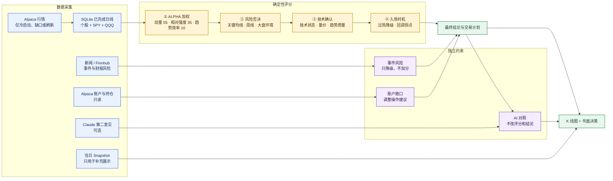
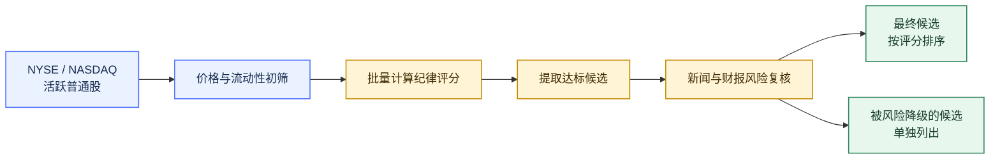

# 什么值得买 · 美股版

把趋势交易纪律落成一套可复现的美股评分流程。它回答的不是“这家公司好不好”，而是：**按当前价量结构、市场环境和风险约束，现在是否适合参与。**

支持单股分析和全市场扫描。输出包括纪律评分、明确结论、计划价位、账户敞口建议、事件风险和 K 线图。

## 能做什么

- 评估单只美股：`是`、`观察`、`否`、`持仓需减风险`或 `无法评分`。
- 扫描 NYSE / NASDAQ，先做流动性过滤，再筛出符合纪律的候选。
- 只读 Alpaca 账户和持仓，把当前仓位、成本及浮盈亏纳入操作建议。
- 检查近 30 天新闻、公告和财报日历；事件风险可以降级结论，利好不加分。
- 生成入场、回踩、止损、2R / 3R 止盈和追价上限。
- 输出终端 K 线与自包含 HTML 图；可选展示 Claude 第二意见作对照。
- 对单个标的做 final-only 历史评分回放、21/63 日事件研究和成本后交易仿真，生成 canonical JSON 与交互式 HTML。

## 快速使用

安装到 Codex skills 目录：

```bash
mkdir -p ~/.codex/skills
git clone https://github.com/starriv/worth-buy-stocks.git \
  ~/.codex/skills/worth-buy-stocks
python3 -m pip install -r ~/.codex/skills/worth-buy-stocks/requirements.txt
```

准备 Python 3.10+、Alpaca CLI 和可读取美股行情的 Alpaca 凭证。完整配置见[本地环境设置清单](references/setup.md)。

然后直接对 Codex 说：

```text
值得买吗 NVDA
分析 AAPL，结合我的 Alpaca 持仓和最近 30 天新闻
扫全市场，找今天符合纪律的候选
简单看一下 MSFT，只给结论
```

仓库根目录提供统一 Make 入口：

```bash
make help
make analyze SYMBOLS=NVDA,SPY,QQQ
make scan TOP=20
```

Makefile 只转发现有 Python CLI，不复制评分或行情逻辑；recipe 保持静默，因此分析 JSON 仍是 stdout 的唯一业务输出。公共配置通过 `PYTHON`、`CACHE_DB`、`FEED` 等变量覆盖，子命令附加 flag 用 `ARGS`，日志等位于 subcommand 之前的全局 flag 用 `GLOBAL_ARGS`。

所有回测由 `scripts/backtest.py` 统一提供；Make 中的 `backtest-factor`、`backtest-score`、`backtest-robustness` 和 `backtest-visual` 都转发该入口。

## 日志与输出通道

所有 CLI 通过 `structlog` 统一记录运行日志：业务 JSON、终端 K 线和回测报告继续写 stdout，进度、告警和异常只写 stderr。默认 `--log-format auto` 在交互终端显示可读 console，stderr 被重定向时输出逐行可解析的 JSONL。

```bash
# stdout 是单一结果 JSON；stderr 重定向后是 JSONL 日志
python3 scripts/indicators.py --symbols AAPL,SPY,QQQ \
  > result.json 2> run.log

# 显式选择格式和级别
python3 scripts/scanner.py --log-format console --log-level WARNING --top 20
```

所有公共入口支持 `--log-level DEBUG|INFO|WARNING|ERROR` 和 `--log-format auto|console|json`。也可设置 `WORTH_BUY_STOCKS_LOG_LEVEL`、`WORTH_BUY_STOCKS_LOG_FORMAT`；CLI 参数优先。日志会统一脱敏常见 key/token/authorization/cookie 字段与异常文本，但调用方仍不得主动记录凭证、完整环境变量或账户原始对象。

## 本地行情缓存

历史已完成日线和最新 snapshot 默认通过 SQLite 读穿缓存，数据库位于 skill 根目录的 `data/market-data.sqlite3`。可用 `WORTH_BUY_STOCKS_DB` 或各 CLI 的 `--cache-db` 覆盖路径；`data/` 是本地运行数据，不应提交。

- `--cache auto`（默认）：完整覆盖时只读数据库；冷启动或缺口只补缺失范围。
- `--cache refresh`：强制刷新请求范围，用于复权修订或手工修复。
- `--cache off`：仅访问 Alpaca，用于无缓存基线和故障排查。
- `--input`：强制离线，只读输入 artifact，不访问数据库或网络；在线开关不能越过此边界。

盘前、周末和节假日优先读取 latest snapshot，缺失时由最近 final bar 合成；盘中只刷新 snapshot/live 日 K，评分仍只读上一完成 session。收盘宽限期结束后，下一次 bars 请求补齐 final bar 并清除对应 live row。

```bash
# 查看/校验缓存（只读）
make status
make integrity

# 预热或强制刷新
make cache-warm SYMBOLS=AAPL,SPY,QQQ
make cache-refresh SYMBOLS=AAPL,SPY,QQQ START=2025-01-01

# 先规划全市场三年缺口（不请求 bars），再按一小时维护窗口安全预热
make warm-market-plan
make warm-market YEARS=3 WORKERS=4 BATCH_SIZE=50 MAX_RPM=120 MAX_RUNTIME=3600

# 每日同步 Alpaca 资产目录，并按全部可用标的查漏补缺
make sync-assets
make reconcile-plan
make reconcile-market YEARS=3 WORKERS=4 BATCH_SIZE=50 MAX_RPM=120 MAX_RUNTIME=3600

# 清理使用独立空默认变量；全库清理还要求 CONFIRM=purge-all
make cache-purge PURGE_SYMBOLS=AAPL START=2026-07-01 END=2026-07-10
make cache-purge-all CONFIRM=purge-all
```

`warm-market` 自动发现 NYSE/NASDAQ scanner 股池，只拉 `iex + split` 的已完成日线，不拉 snapshot。所有分页与重试共享本进程的均匀限速器；默认 120 RPM、允许上限 180，低于 Alpaca Basic 的 200 RPM，但无法约束同账号运行的其他程序。命令按 `sync_ranges` 自动续传，同一数据库只允许一个实例；Ctrl-C、维护窗口到期或单 batch 失败后可直接复跑。`--symbols-file` 只用于低速 canary/复现，其完成状态不代表全市场。

`sync-assets` 每个 UTC 日期最多远端刷新一次，将 Alpaca 当前 active US equity 写入同一个 SQLite，并保留不再出现的资产历史。`reconcile-market` 以目录中当前、可交易、Basic IEX 可覆盖的标的为目标，复用 warm-market 的缺口规划、限速和断点续传；非交易资产和 OTC 会保留并标明排除原因。完整任务必须显式运行，建议先 dry-run；`status` 会显示资产目录时间、目标数和三年覆盖缺口。

## 单标的可视化回测

缓存覆盖充分后，一条命令即可对单个标的做逐交易日评分回放，并生成 JSON 与自包含 HTML：

```bash
make backtest-visual SYMBOL=AAPL START=2021-07-01 END=2026-07-09
```

回测默认 `cache-only`：SQLite 以只读模式打开，不补网、不迁移、不写 coverage，只使用标的、SPY、QQQ 的 final 日线。周末、休市日、未收盘当天或未来的结束日会依据库内交易日历截到最近完成 session；已完成 session 的真实缺口或不足 260 个 session 的预热仍会明确失败。需要补齐时先显式运行 `make cache-warm SYMBOLS=AAPL,SPY,QQQ START=2020-07-01 END=2026-07-09`，然后重跑回测。输出默认落在 gitignored 的 `artifacts/backtests/`，语义 hash 用于确认同数据、模型和参数下的结果可复现。

报告同时展示 21/63 日绝对及相对收益事件研究、非重叠推断样本、rank-only 与 disciplined-verdict 的下一开盘固定研究窗口，以及执行建议仓位、初始止损、1R 保本、移动保护和下一开盘信号退出的 managed 仿真。固定窗口 marker 明确标为研究起点/窗口终点，不代表系统识别高位。HTML 只渲染 canonical artifact，不重算业务指标；历史回测不回填新闻、账户、Snapshot、Finnhub 或 AI opinion。

contract 1.4 另行保留 stateful 实验场景及其恢复/重新入场状态记录。该场景未通过预注册的 16 标的 holdout；随后排除 QQQ/SPY、补齐缓存并对 4 个宽基与 11 个行业 ETF 做分层 holdout，收益改善率也只有 13.33%，再次判定 reject。报告明确标为“已拒绝”，旧 managed 继续作为正式基线。

指数 ETF 分层验证统一由 `make backtest-index-lifecycle-validate` 调用。正式报告中 15/15 ETF 有效，仅 IWM、XLI 改善；6 个 ETF 两个场景均无交易，说明现有首次入场评分仍限制指数参与度。对实际触发 stateful 转换的 9 个 ETF，收益差中位数为 −1.4435%、Sharpe 差中位数为 −0.3559、回撤差中位数为 −4.2901 个百分点、换手比中位数为 2.4286。不得据此升级 ETF 专用生命周期，也不得在同一 holdout 上调参。

2021-07-01 至 2026-07-09 的 AAPL v1.1 验收结果为 `inconclusive`：63 日非重叠推断样本 19 个，其中最终结论为“是”的样本仅 1 个，不能据此确认或否定评分有效性。完整口径和证据见 [Model Card](docs/model-card.md) 与[回测契约](docs/backtesting-contract.md)。

2023-07-03 至 2026-07-09 的 QQQ v1.2 修复验收同样为 `inconclusive`：自基准、超跌反转、计划仓位和 managed 退出已经修正，managed 收益由旧 artifact 的 −7.45% 改善到 +7.09%，但同期 QQQ 买入持有为 +95.29%，且 63 日“是”组相对非“是”组的置信区间方向不利。报告因此只证明执行缺陷被修复，不证明评分 alpha 有效。

## 输出示例


完整分析按固定结构输出：结论、关键证据、风控过滤条件、评分拆解、账户敞口与交易计划、新闻面风控、建议。需要简短回答时，可以只保留图表和结论。

## 实现原理

### 单股分析流程



评分分四层，各层职责分开：

| 层         | 依据                                                | 作用                     |
| ---------- | --------------------------------------------------- | ------------------------ |
| ALPHA 加权 | 风险调整动量、相对 SPY / QQQ 强度、Kaufman 趋势效率 | 形成排名分               |
| 风险否决   | MA60、MA200、周线结构、大盘 risk-off                | 封顶或否决，避免逆势开仓 |
| 技术确认   | MACD、RSI、KDJ、量价和趋势质量                      | 只拦截买入，不给排名加分 |
| 入场时机   | 过热程度、有序回调、完成日线反转信号                | 调整入场结论，不改排名分 |

新闻面不是第五个评分因子。高风险事件会封顶或降级，利好、目标价和估值叙事不会把弱势标的升级。账户敞口只影响操作建议；AI 意见只用于对照。

### 全市场扫描流程



评分权重来自样本内回测和逐因子 IC 分析，但扩展到规则化宽票池后，排名优势未达到统计显著。这里的分数用于统一执行纪律，不应理解为已经验证的选股 alpha。详细证据和限制见 [Model Card](docs/model-card.md)。

## 数据与可选能力

| 能力                     | 来源或配置                               | 是否必需 | 对结论的影响                      |
| ------------------------ | ---------------------------------------- | -------: | --------------------------------- |
| 日线、基准和当日行情     | 本地 SQLite + Alpaca CLI                 |       是 | final 日线进入评分；live/Snapshot 只补充展示 |
| 账户与持仓               | Alpaca 只读接口                          |       否 | 调整持仓和仓位建议，不改排名分    |
| 公司新闻、资料和财报日历 | `FINNHUB_API_KEY`                        |       否 | 只识别降级风险                    |
| AI 第二意见              | `ANTHROPIC_API_KEY` + `anthropic` SDK    |       否 | 只展示对照，不改结论              |
| Telegram 推送            | `TELEGRAM_BOT_TOKEN`、`TELEGRAM_CHAT_ID` |       否 | 只发送结果                        |

默认使用 Alpaca `iex` feed。只有账户具备 SIP 权限且明确需要时才切换到 `sip`。

可选密钥从以下位置依次读取：

1. `WORTH_BUY_STOCKS_ENV_FILE` 指定的文件；
2. skill 根目录下的 `.env`；
3. `~/.config/worth-buy-stocks/.env`。

不要把密钥提交到仓库，也不要发到对话中。未配置可选能力时，核心价量评分仍可运行。

## 使用边界

- 仅支持 Alpaca 覆盖的美股标的。
- 核心价量数据不足时返回 `无法评分`，不会用猜测补齐。
- 全市场扫描是纪律过滤，不是收益预测或宽基选股 alpha 排名。
- 当前校准主要是样本内结果，宽票池优势未被验证，也未经历完整熊市周期的样本外检验。
- 部分阈值仍是手工设定，需继续通过前瞻日志验证。
- 计划价位来自 ATR、均线和近 30 日结构，用于风险管理，不是订单指令。

## 项目文档

- [本地环境设置](references/setup.md)
- [评分模型与校准证据](docs/model-card.md)
- [单标的回测契约](docs/backtesting-contract.md)
- [单标的可视化回测实现与验收](docs/feature/005-single-symbol-visual-backtest.md)
- [脚本架构、命令和回测说明](scripts/README.md)
- [并行采集数据契约](references/agent-contracts.md)

## 相关项目

[Vicu](https://github.com/starriv/Vicu#) 是一个面向 Alpaca 的 iOS 客户端，可配合本 skill 查看账户与行情。

## 免责声明

本项目用于研究、纪律检查和交易复盘，不构成投资建议。市场有风险，请根据自己的目标、期限和风险承受能力独立决策。
