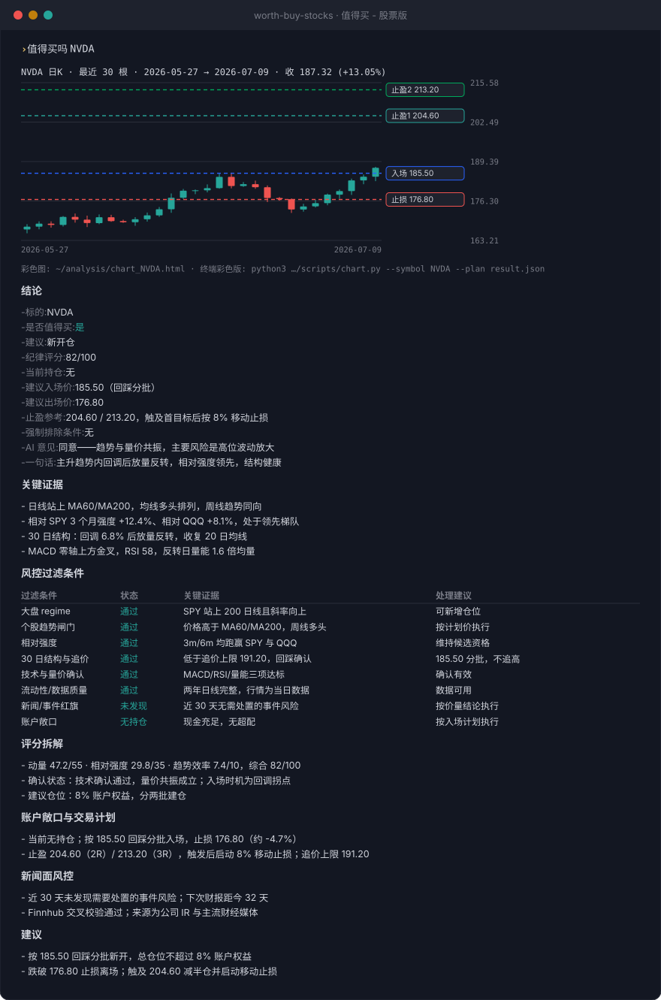
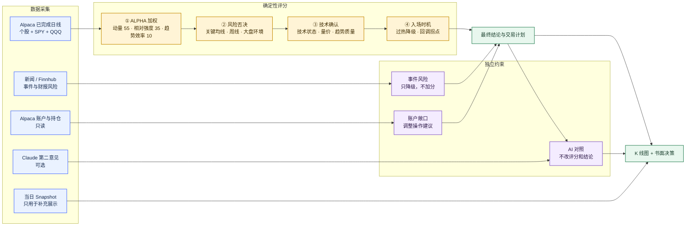
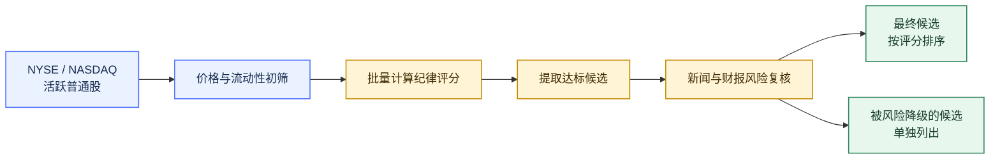

# 什么值得买 · 美股版

把趋势交易纪律落成一套可复现的美股评分流程。它回答的不是“这家公司好不好”，而是：**按当前价量结构、市场环境和风险约束，现在是否适合参与。**

支持单股分析和全市场扫描。输出包括纪律评分、明确结论、计划价位、账户敞口建议、事件风险和 K 线图。

## 能做什么

- 评估单只美股：`是`、`观察`、`否`、`持仓需减风险`或 `无法评分`。
- 扫描 NYSE / NASDAQ，先做流动性过滤，再筛出符合纪律的候选。
- 只读 Alpaca 账户和持仓，把当前仓位、成本及浮盈亏纳入操作建议。
- 检查近 30 天新闻、公告和财报日历；事件风险可以降级结论，利好不加分。
- 生成入场、回踩、止损、2R / 3R 止盈和追价上限。
- 输出终端 K 线与自包含 HTML 图；可选展示 Claude 第二意见作对照。

## 快速使用

安装到 Codex skills 目录：

```bash
mkdir -p ~/.codex/skills
git clone https://github.com/starriv/worth-buy-stocks.git \
  ~/.codex/skills/worth-buy-stocks
```

准备 Python 3.10+、Alpaca CLI 和可读取美股行情的 Alpaca 凭证。完整配置见[本地环境设置清单](references/setup.md)。

然后直接对 Codex 说：

```text
值得买吗 NVDA
分析 AAPL，结合我的 Alpaca 持仓和最近 30 天新闻
扫全市场，找今天符合纪律的候选
简单看一下 MSFT，只给结论
```

也可以直接运行脚本：

```bash
# 单股评分；SPY、QQQ 用于市场环境和相对强度比较
python3 scripts/indicators.py --symbols NVDA,SPY,QQQ

# 全市场扫描
python3 scripts/scanner.py --top 20
```

## 输出示例



完整分析按固定结构输出：结论、关键证据、风控过滤条件、评分拆解、账户敞口与交易计划、新闻面风控、建议。需要简短回答时，可以只保留图表和结论。

## 实现原理

### 单股分析流程



评分分四层，各层职责分开：

| 层         | 依据                                                | 作用                     |
| ---------- | --------------------------------------------------- | ------------------------ |
| ALPHA 加权 | 风险调整动量、相对 SPY / QQQ 强度、Kaufman 趋势效率 | 形成排名分               |
| 风险否决   | MA60、MA200、周线结构、大盘 risk-off                | 封顶或否决，避免逆势开仓 |
| 技术确认   | MACD、RSI、KDJ、量价和趋势质量                      | 只拦截买入，不给排名加分 |
| 入场时机   | 过热程度、有序回调、完成日线反转信号                | 调整入场结论，不改排名分 |

新闻面不是第五个评分因子。高风险事件会封顶或降级，利好、目标价和估值叙事不会把弱势标的升级。账户敞口只影响操作建议；AI 意见只用于对照。

### 全市场扫描流程



评分权重来自样本内回测和逐因子 IC 分析，但扩展到规则化宽票池后，排名优势未达到统计显著。这里的分数用于统一执行纪律，不应理解为已经验证的选股 alpha。详细证据和限制见 [Model Card](docs/model-card.md)。

## 数据与可选能力

| 能力                     | 来源或配置                               | 是否必需 | 对结论的影响                      |
| ------------------------ | ---------------------------------------- | -------: | --------------------------------- |
| 日线、基准和当日行情     | Alpaca CLI                               |       是 | 日线进入评分；Snapshot 只补充展示 |
| 账户与持仓               | Alpaca 只读接口                          |       否 | 调整持仓和仓位建议，不改排名分    |
| 公司新闻、资料和财报日历 | `FINNHUB_API_KEY`                        |       否 | 只识别降级风险                    |
| AI 第二意见              | `ANTHROPIC_API_KEY` + `anthropic` SDK    |       否 | 只展示对照，不改结论              |
| Telegram 推送            | `TELEGRAM_BOT_TOKEN`、`TELEGRAM_CHAT_ID` |       否 | 只发送结果                        |

默认使用 Alpaca `iex` feed。只有账户具备 SIP 权限且明确需要时才切换到 `sip`。

可选密钥从以下位置依次读取：

1. `WORTH_BUY_STOCKS_ENV_FILE` 指定的文件；
2. skill 根目录下的 `.env`；
3. `~/.config/worth-buy-stocks/.env`。

不要把密钥提交到仓库，也不要发到对话中。未配置可选能力时，核心价量评分仍可运行。

## 使用边界

- 仅支持 Alpaca 覆盖的美股标的。
- 核心价量数据不足时返回 `无法评分`，不会用猜测补齐。
- 全市场扫描是纪律过滤，不是收益预测或宽基选股 alpha 排名。
- 当前校准主要是样本内结果，宽票池优势未被验证，也未经历完整熊市周期的样本外检验。
- 部分阈值仍是手工设定，需继续通过前瞻日志验证。
- 计划价位来自 ATR、均线和近 30 日结构，用于风险管理，不是订单指令。

## 项目文档

- [本地环境设置](references/setup.md)
- [评分模型与校准证据](docs/model-card.md)
- [脚本架构、命令和回测说明](scripts/README.md)
- [并行采集数据契约](references/agent-contracts.md)

## 相关项目

[Vicu](https://github.com/starriv/Vicu#) 是一个面向 Alpaca 的 iOS 客户端，可配合本 skill 查看账户与行情。

## 免责声明

本项目用于研究、纪律检查和交易复盘，不构成投资建议。市场有风险，请根据自己的目标、期限和风险承受能力独立决策。
