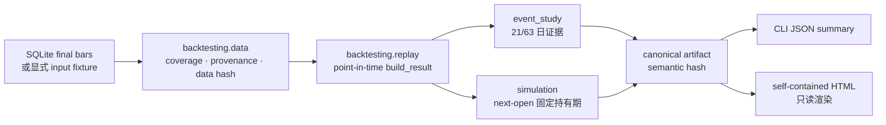

# 单标的可视化回测

> 本文记录 v1.1 / contract 1.0 的首版交付证据。当前契约已由后续反转与退出修复升级到 1.3；固定路径是研究窗口，managed 执行建议仓位与持仓保护。现行定义与 QQQ v1.2 证据以 `docs/backtesting-contract.md` 和 `docs/model-card.md` 为准。

## 交付结果

本功能把历史研究拆成独立 `scripts/backtesting/` 包，并以 `scripts/backtest.py` 作为唯一 CLI。同一条生产评分链路现在可以在每个历史信号时点重放，形成 canonical JSON，再由只读渲染器生成自包含 HTML。

首版回答两个不同问题：

- 事件研究：某个历史分数/结论出现后，未来 21/63 个交易日的标的收益与相对 SPY/QQQ 超额收益如何。
- 交易仿真：如果只按 rank-only 或 disciplined-verdict 入场，在下一交易日开盘成交、固定持有 21/63 日并扣单边 10bp，账本、权益和回撤如何。

二者都不能单独证明宽市场 alpha；自动结论只按冻结的 63 日非重叠样本、组样本下限和 bootstrap 置信区间给出 `supports`、`inconclusive`、`contradicts` 或数据无效时的 `invalid_run`。

## 架构



主要边界：

- `contracts.py` 冻结研究版本、窗口、成本、预热和验证下限。
- `data.py` 提供 `cache-only`、`auto`、`input`；默认只读 SQLite schema v3 的 final rows，完全排除 live/Snapshot。
- `replay.py` 只切片，不复制权重、闸门或 verdict；唯一评分实现仍是 `pipeline.build_result()` → `scoring.score()`。
- `event_study.py` 的全部重叠样本只作描述，非重叠样本才进入 IC、CI 和自动判断。
- `simulation.py` 维护下一开盘、固定持有期、成本、跳过信号、交易 ledger、权益、回撤和 buy-and-hold 基准。
- `artifact.py` 负责 schema、无 NaN 校验、原子写入与稳定语义 hash；生成时间和数据库绝对路径不参与语义 hash。
- `visualization.py` 只消费 artifact，内嵌价格/评分、交易标记、权益/回撤、证据、交易表、排除原因和 provenance，不加载外部资产。
- `panel.py`、`cross_sectional.py` 与 `universe.py` 承担宽票池取数和三类研究；统一 CLI 通过 `factor-ic`、`score`、`robustness` 子命令调用。

完整研究和执行定义见 [`docs/backtesting-contract.md`](../backtesting-contract.md)。

## 使用

缓存覆盖充分时：

```bash
make backtest-visual SYMBOL=AAPL START=2021-07-01 END=2026-07-09
```

显式离线 fixture：

```bash
python3 scripts/backtest.py single \
  --symbol AAPL --start 2021-01-04 --end 2025-12-31 \
  --data-source input --input bars.json
```

从 canonical JSON 重建页面：

```bash
python3 scripts/backtest.py render \
  --artifact artifacts/backtests/<artifact>.json \
  --html artifacts/backtests/rerendered.html
```

成功的 `single` 默认把 `<symbol>-<actual-start>-<actual-end>-<hash>.json/.html` 写入 gitignored 的 `artifacts/backtests/`。CLI stdout 是单一 JSON 结果，结构化运行日志只写 stderr。

## 真实 AAPL 验收

2026-07-10 对本地 schema v3 缓存显式补齐 AAPL/SPY/QQQ 后，按以下冻结配置运行两次 cache-only：

```bash
python3 scripts/backtest.py --log-format json single \
  --symbol AAPL --start 2021-07-01 --end 2026-07-09 \
  --data-source cache-only --signal-step 1 \
  --output-dir artifacts/backtests
```

- 实际区间：2021-07-01 至 2026-07-09；每个 symbol 共读取 1,490 根 final bar（含预热），coverage 无缺口。
- 版本：model `v1.1`、contract/artifact `1.0`。
- data hash：`8bc3a7e9f6cbd682e717a4623ae7cac7280fb824da297f05f1ee94d3092cbade`。
- 两次 semantic hash 均为 `909b73190a64837b0e37c3700d41c2463b1e8cc44252dfeb47b080fb69c17268`；第二次没有 transport 事件。
- 21 日：描述 N=1,239，非重叠推断 N=59，时间序列 IC=−0.1942。
- 63 日：描述 N=1,197，非重叠推断 N=19，时间序列 IC=−0.3115。
- 63 日 rank-only：总收益 −15.1426%，最大回撤 −30.7895%，8 笔交易。
- 63 日 disciplined-verdict：总收益 +0.1813%，最大回撤 −22.5687%，5 笔交易。
- 同期 AAPL / SPY buy-and-hold：+130.3534% / +74.5882%。

自动结论为 `inconclusive`。63 日“是”组非重叠样本只有 1 个，未达到冻结下限 8，无法形成可靠的组均值及差值置信区间。负 IC 和策略落后基准作为负面证据完整保留，但不能在样本不足时改写成 `contradicts`。

## 验证

- 1,300 个评估 bars、3 symbols 的 deterministic E2E 覆盖 data → replay → study → simulation → JSON → HTML，耗时约 2.63 秒（性能专用 `signal_step=13`，artifact 按契约标记 `invalid_run`，45 秒上限）。
- 真实 AAPL 约五年逐日完整回放与 HTML 生成耗时约 30.08 秒，低于 45 秒验收上限。
- 单元与集成测试覆盖未来数据变形不变性、生产评分 parity、cache-only 零 transport/零写入/final-only、coverage/schema 失败、下一开盘与成本、ledger/权益/回撤恒等、artifact hash、HTML 转义与旧 CLI 兼容。
- 内嵌 artifact 可解析、页面 JavaScript 可编译，九个关键 DOM 节点均存在。Codex in-app Browser 的本地 `file://` URL 策略阻止了自动视觉点击验收；未绕过该策略，HTML 仍可由用户直接打开检查。

## 明确不做

- 不历史回填新闻、账户、Finnhub、Snapshot 或 AI opinion。
- 不按日线内高低价模拟 trade plan 止损止盈，不解决同日触发顺序歧义。
- 不做组合资金分配、参数寻优、滚动再训练、分钟级撮合或实盘下单。
- 不把单个 ticker 的结果外推成宽市场有效性结论。
