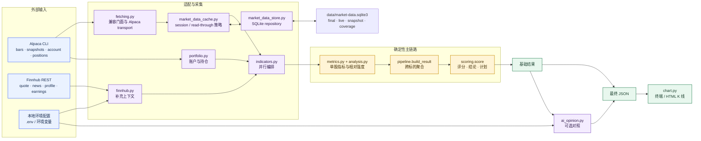
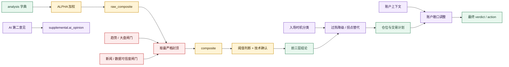

# scripts/ 工程说明

`worth-buy-stocks` 的脚本层维护文档。这里说明运行链路、评分规则、模块边界和验证方式；使用说明见[根目录 README](../README.md)，Codex 执行约束见 [SKILL.md](../SKILL.md)。

运行时以 Python 标准库、本机 Alpaca CLI 和强制依赖 `structlog==26.1.0` 为主。Finnhub、Claude API 和 Telegram 都是可选能力，其中 Claude API 额外依赖官方 `anthropic` SDK。

## 导航

- [运行约束](#运行约束)
- [统一日志](#统一日志)
- [运行架构](#运行架构)
- [评分引擎](#评分引擎)
- [指标计算](#指标计算)
- [回测与校准](#回测与校准)
- [模块职责](#模块职责)
- [常用命令](#常用命令)
- [修改与验证](#修改与验证)

## 运行约束

| 约束 | 实现方式 |
|---|---|
| 评分来源唯一 | `scoring.score()` 生成分数、结论和计划；其他模块只准备输入或展示结果 |
| 计算可复现 | `metrics.py` 和 `scoring/` 对相同输入产生相同输出 |
| 缺失值保真 | 历史不足时返回 `None`，下游显示“无法确认”或“无法评分”，不退化为 0 |
| 外部能力隔离 | 账户、Finnhub、Snapshot 和 AI 意见各自失败时独立降级 |
| 数据角色固定 | 日线进入评分；新闻只降级；账户只调敞口建议；AI 意见只写入补充信息 |
| 凭证不进入结果 | 密钥由 `local_env.py` 读取；账户适配层过滤账号标识 |
| 日线口径稳定 | 默认使用 `iex`；SQLite 只向评分提供 final rows，盘中 live/Snapshot 单独展示 |

`indicators.py` 保留旧版再导出，已有的 `import indicators as I` 仍可使用。新增逻辑应放到职责对应的模块，不继续扩大 CLI 文件。

## 统一日志

`skill_logging.py` 是唯一日志门面。CLI 入口调用 `add_logging_arguments()` 和 `configure_logging()`；业务模块只调用 `get_logger()`/`logger.bind()`，不得自行配置 handler、直接写 stderr 或调用 root `logging.*`。

- stdout：JSON artifact、终端 K 线、回测与 forward-log 报告。
- stderr：运行生命周期、progress/heartbeat、降级告警与异常。
- `--log-format auto`：TTY 使用 console，非 TTY 使用 JSONL；可显式指定 `console|json`。
- `--log-level`：`DEBUG|INFO|WARNING|ERROR`，默认 INFO。
- 环境变量：`WORTH_BUY_STOCKS_LOG_FORMAT`、`WORTH_BUY_STOCKS_LOG_LEVEL`；CLI 优先。
- JSONL 最小字段：UTC `timestamp`、`level`、snake_case `event`、`worth_buy_stocks.*` `logger`；其余使用低基数上下文字段。
- processor 会递归脱敏 key/secret/token/authorization/cookie/password/credential 以及 URL/header/异常文本中的常见凭证形式。禁止把完整 artifact、账户对象、环境或请求头主动传给 logger。

`cache_admin` 的长任务 progress 与 heartbeat 也走同一门面：重定向 stderr 时每个非空行都是独立 JSON，对 stdout 最终 summary 无影响。静态测试 `tests/test_logging_guard.py` 阻止 raw stderr、root logger、自写 JSON 日志和绕过 facade 的 `structlog` 调用重新进入业务代码。

## 运行架构

### 单股运行链路



`indicators.py` 会并行取得 bars、账户、Finnhub 和 Snapshot；bars/snapshot 先由 session-aware cache 决定 DB 或 Alpaca，Finnhub 内部再按 symbol 并行。`pipeline.build_result()` 负责补齐 SPY / QQQ 相对强度和市场状态，再逐只调用 `scoring.score()`。Snapshot 与 Finnhub 原始上下文写入 `supplemental`，不进入排名分。

`scanner.py` 复用同一条分析与评分链路，额外执行：股池获取 → 流动性初筛 → 批量评分 → 候选提取 → 新闻复核。无需在外层重复拆分抓取步骤。

### 并行数据契约

外部并行采集只允许产出 `bars`、`news_context`、`account_context`、`finnhub_context`、`snapshot_context` 或 `ai_opinion` 等约定结构。评分仍由主链路统一执行，不接受多个评分结果投票。

契约定义见[并行采集数据契约](../references/agent-contracts.md)。校验命令：

```bash
python3 scripts/validate_agent_contract.py --kind <kind> <artifact>.json
```

可选上下文校验失败时丢弃该上下文；核心 bars 校验失败时停止评分。

## 评分引擎

### 决策流程



### 排名分

`raw_composite` 按可用权重重新归一到 0–100；某个非核心因子缺失时不会直接记 0。相对强度缺失属于核心数据不完整，最终返回 `无法评分`。

| 因子 | 权重 | 计算口径 |
|---|---:|---|
| `momentum` | 55 | 风险调整 6 个月动量占 60%，12-1 动量占 40%，分别经 logistic 映射 |
| `rel_strength` | 35 | 3 个月和 6 个月各取相对 SPY / QQQ 的较弱值，再取均值并映射 |
| `efficiency` | 10 | 30 日 Kaufman 效率比，截断到 `[0, 1]` |

logistic 映射统一采用：

```text
score = 1 / (1 + e^(-k × (x - x0)))
```

`x0` 是 50 分对应点，`k` 控制曲线陡度。具体参数集中在 `scoring/factors.py`；部分参数仍是手工设定，修改时必须同步 Model Card。

### 风险闸门与结论

| 条件 | 分数上限 |
|---|---:|
| 价格低于 MA200，且 MA200 下行 | 55 |
| 价格低于 MA200 | 70 |
| 周线均线空头排列 | 50 |
| 价格低于 MA60 | 65 |
| SPY 低于自身 MA200 | 65 |
| 高危事件红旗 | 50 |
| 中危事件红旗或数据存疑 | 74 |

技术确认不进入排名分。`technical ≥ 0.50`、`volume ≥ 0.40`、`trend_quality ≥ 0.40` 全部满足，才允许高分标的进入 `是`。

| composite 与条件 | 基础结论 |
|---|---|
| 缺少 composite 或相对强度 | `无法评分` |
| `≥ 75`、无趋势闸门、确认通过 | `是` |
| `≥ 75`、确认不足 | `观察` |
| `60–74.9` | `观察` |
| `< 60` | `否` |

新闻利好、分析师目标价和估值叙事只回显，不会提高分数。事件红旗通过 `min(cap)` 进入最终封顶。

### 入场时机

入场时机只改变结论、动作和计划，不改 `composite`。

| 分类 | 判定重点 | 处理 |
|---|---|---|
| `overextended` | 距 MA20 ≥ 3 ATR，或 RSI14 ≥ 80，或软阈值同时满足 | 将基础 `是` 降为 `观察`，给出回踩价 |
| `pullback_reversal` | 趋势仍有效，先高后低形成回调，完成日线反转，且至少两个独立触发信号 | 可替代 technical / trend_quality 确认；volume 必须明确达标 |
| `recovery_reversal` | 结构回撤至少 12%，反转日涨幅/强收盘/量能/多重确认全部达标，且长期均线仍上行 | 不改排名分；允许最多 15% 独立试仓，结构低点止损 |
| `pullback_no_trigger` | 已回调但反转信号不足 | 保持原结论 |
| `trend_continuation` | 趋势正常推进且未过热 | 保持原结论 |
| `trend_broken` | 中期趋势结构破坏 | 交给趋势闸门处理 |

时机阈值属于 v1.2 的待验证参数。`forward_log.py` 会记录介入前结论和时机分类，跨模型版本不得混算。

### 仓位、计划与账户

反波动率仓位建议：

```text
仓位比例 = min(20% / 3 个月年化波动率, 1) × composite / 100
```

`trade_plan.py` 使用 ATR14、MA60 和近 30 日结构生成入场、回踩、突破、追价上限、保护价、2R / 3R 止盈和移动止损；超跌反转使用结构低点止损与至少 10% 的延迟移动保护。managed 回测执行建议仓位，达到 1R 后转保本并激活移动保护。账户上下文不改 `composite`，但可以把最终结论调整为 `持仓需减风险`。

### 可选上下文

| 上下文 | 模块 | 作用 |
|---|---|---|
| 当日 Snapshot | `fetching.py` | 展示最新价、报价和成交，不参与评分 |
| 账户与持仓 | `portfolio.py` | 计算当前敞口、目标仓位和持仓处理建议 |
| Finnhub | `finnhub.py` | 补充 quote、profile、news、earnings，并提炼事件风险候选 |
| 手工新闻上下文 | `--llm-context-file` | 输入可验证红旗、数据可信度和来源 |
| AI 第二意见 | `ai_opinion.py` | 评分后生成 buy / watch / avoid 对照，只写入 `supplemental` |

AI 意见载荷采用字段白名单，输入中不含 `verdict`、`composite` 和 `trade_plan`。一致或分歧由脚本比较，不采用模型自述。详细设计见 [AI opinion overlay](../docs/ai-opinion-overlay-design.md)。

## 指标计算

| 处理 | 当前实现 |
|---|---|
| EMA / MACD 预热 | MACD 使用 SMA-seeded EMA，最低历史约为 `slow + signal + 5` |
| 历史不足 | 指标返回 `None`，缺失项从可用权重分母剔除 |
| 周线聚合 | 按实际交易周聚合，不按每 5 根日线硬切；未完成周标记 `last_week_partial` |
| 盘中日线 | `fetching.py` 剔除未收盘的当日日线，保证评分只使用完成数据 |
| 相对强度 | 同一日期截面对比 SPY / QQQ 的 3 个月和 6 个月收益 |
| 流动性 | 20 日均成交额低于 500 万美元只记录警示，不封顶 |

指标原语集中在 `metrics.py`，不触网、不读写文件。新增指标应保持纯函数，并为历史不足、边界值和典型路径补单元测试。

## 回测与校准

| 脚本 | 用途 | 方法 |
|---|---|---|
| `backtest.py factor-ic` | 检查单因子方向 | 截面 Spearman IC |
| `backtest.py score` | 检查综合评分与确认层 | 分桶、五分位价差、截面 IC、确认层 A/B |
| `backtest.py robustness` | 检查结果稳定性 | 非重叠窗口、regime / 行业中性拆分、bootstrap CI、幸存者探针 |
| `backtest.py single` | 检查单标的历史时序证据 | point-in-time 评分、21/63 日研究窗口、计划仓位 managed 持仓保护、自包含 HTML |
| `backtest.py render` | 重建可视化报告 | 校验 canonical artifact 后只做展示，不重算研究指标 |
| `backtest.py managed-ablation` | research-only 执行层消融 | 共享单次 replay 跑 managed 基线 + 出场/入场时机/仓位变体，冻结 holdout 门槛评审 |
| `backtest.py signal-ablation` | research-only 信号层消融 | 时间线后处理改写 verdict（过热梯度、确认放宽、相对强度门槛），执行层冻结 |
| `backtest.py rotation-study` | 横截面 Top-N 轮动组合研究 | 预注册配置矩阵、dev 选优 + holdout 双门槛（收益/回撤 vs QQQ）、日频权益与成本 |
| `backtest.py pragmatic-entry-validate` | 重放已拒绝的务实分段入场 v0 | 试仓/确认/退出/冷却状态迁移、追价、MFE/MAE、成本与首批独立 holdout |
| `backtest.py pragmatic-entry-v1-validate` | 重放已拒绝的务实分段入场 v1 | 5% 试仓、未确认退出、基线仓位保真与第二批独立 holdout；不得作为生产策略 |
| `rotation_list.py` | 轮动策略当日名单 | 用晋升配置（63 日调仓 Top-20 等权 + SPY 200 日线 regime）输出目标名单与持仓 diff |
| `forward_log.py` | 积累样本外记录 | 固化当日评分，满 63 个交易日后按结论和时机分类对账 |

使用 Spearman 是因为评分关注排序，且秩相关不易被单只股票的极端收益主导。采用截面 IC 是为了减少市场整体涨跌对结果的干扰。

当前 Model Card 的关键结论：

- 校准样本为 2020-07 至 2026-06，结果均属于样本内证据。
- 45 只手工大盘股篮子可测得正 IC，但存在明显的后见之明。
- 扩展到 132 只规则化股票并加入退市样本后，63 日全样本 IC 为 `+0.013`，置信区间跨 0，五分位毛价差为 `-0.64%`。
- 样本只包含 2022 一个熊市，regime 结论不能外推为稳定规律。
- logistic 参数、确认阈值、封顶值和结论分界仍含手工自由度。

因此，`composite` 用于统一执行纪律和风险过滤，不应解释为已经验证的宽票池选股 alpha。完整参数、证据与版本记录见 [Model Card](../docs/model-card.md)。

单标的回测与上述横截面校准互补，不替代它。它严格对 TICKER、SPY、QQQ 按每个信号时点切片后调用生产 `pipeline.build_result()`；SPY/QQQ 作为研究标的时排除自身相对强度基准。事件研究的重叠样本只做描述，自动判断只使用非重叠推断样本。仿真在信号后的下一交易日开盘执行，比较 rank-only 与 disciplined-verdict 的 21/63 日研究窗口，以及执行建议仓位、初始止损、1R 保本、移动保护和下一开盘信号退出的 managed 场景。详细定义见[回测契约](../docs/backtesting-contract.md)。

## 模块职责

| 模块 | 职责 |
|---|---|
| `indicators.py` | 单股 CLI；并行采集外部上下文，调用主链路并输出 JSON；兼容旧版再导出 |
| `pipeline.py` | 跨标的聚合、SPY / QQQ 相对强度、市场状态和 overlay 合并 |
| `analysis.py` | 单股分析与跨标的相对强度计算 |
| `metrics.py` | 技术指标、量化因子、周线聚合和入场时机原语 |
| `scoring/engine.py` | 评分主流程与最终结构组装 |
| `scoring/factors.py` | ALPHA、技术、量价和趋势质量映射 |
| `scoring/gates.py` | 趋势闸门、事件封顶、确认阈值和数据标记 |
| `scoring/trade_plan.py` | 反波动率仓位与计划价位 |
| `scoring/account_overlay.py` | 当前持仓、目标敞口和持仓结论调整 |
| `fetching.py` | 日线/Snapshot 兼容门面与纯 Alpaca transport；支持 `auto\|refresh\|off` |
| `market_data_cache.py` | XNYS session 分类、缺口/重叠校验、final/live 分流和故障回退 |
| `market_data_store.py` | SQLite schema、WAL、coverage、final/live/snapshot repository |
| `cache_admin.py` | 只读 status/integrity、warm/refresh 与受保护 purge |
| `portfolio.py` | Alpaca 账户和持仓读取、归一化与敏感字段过滤 |
| `finnhub.py` | Finnhub 请求、错误归一化和事件风险候选提炼 |
| `ai_opinion.py` | 可选的评分后第二意见与结构校验 |
| `local_env.py` | `.env` 查找与可选凭证读取 |
| `agent_contracts.py` / `validate_agent_contract.py` | 并行产物契约定义与 CLI 校验 |
| `scanner.py` | 全市场扫描、流动性初筛、两轮评分和新闻复核 |
| `options_seller.py` | 模块化期权策略 CLI；策略选择、纽约交易日边界、两阶段扫描和离线契约编排 |
| `options_engine/setup.py` | BOLL 触轨收回/回落形态、趋势兼容与标的流动性 |
| `options_engine/volatility_surface.py` | 当前链 ATM IV、25Δ 偏斜、期限结构与一倍标准差预期波动 |
| `options_engine/regime.py` | SPY/QQQ 趋势与实现波动率市场状态门控 |
| `options_engine/structure_optimizer.py` | ATR 动态宽度与 safety/balanced/income 候选标记 |
| `options_engine/iv_history.py` | 固定 30D IV 总方差插值、每日 point-in-time 快照与历史 Rank/Percentile |
| `options_engine/portfolio_risk.py` | 标准 OCC 垂直价差配对、方向调整后的损失相关、单标的/同到期/相关组/总风险集中度 |
| `options_engine/lifecycle.py` | 已有信用价差的止盈、14/7 DTE 双层退出、Delta、短腿穿越与事件退出纪律 |
| `options_engine/ledger.py` | 用户确认开仓、分批平仓成交分录、剩余数量、生命周期历史与描述性绩效的本地 SQLite 审计台账 |
| `options_engine/lifecycle_live.py` | Alpaca 逐腿持仓核对、当前期权链、IEX 现价与事件自动补全 |
| `options_engine/lifecycle_reporting.py` | 生命周期告警分级、中文 Markdown/JSON 日报与 Telegram 短摘要 |
| `options_engine/lifecycle_notifications.py` | 显式启用、失败隔离的可选 Telegram 生命周期通知 |
| `options_position_manager.py` | add/list/close/history/review/performance 台账 CLI；实时路径保持账户只读 |
| `options_engine/data.py` / `live.py` | 期权合约/快照归一化、OPRA 回退、资产股池和事件采集 |
| `options_engine/spreads.py` | 标准同系列 Bull Put/Bear Call 构造、乘数风险、净 Greeks 与淘汰诊断 |
| `options_engine/multi_leg.py` | 多腿合约归一化、保守净权利金、组合净 Greeks 与逐腿可执行性校验 |
| `options_engine/scoring.py` / `events.py` | 报价新鲜度、公司与美国宏观事件硬闸门、费用后经济性、账户风险预算和卖方适配分 |
| `options_engine/strategies/vertical_credit.py` | BOLL 垂直信用价差的独立初筛、构造、评分和代表结构 |
| `options_engine/strategies/calendar_iv.py` | 同执行价跨期长日历的净 Delta、IV 期限差、Vega/Theta、借记与指派风控 |
| `options_engine/strategies/iron_condor.py` | BOLL 中性区间初筛、同到期对称四腿构造、双侧风险、净 Greeks 与独立评分；scan 账户中立，analyze 才叠加账户风险 |
| `options_engine/strategies/iron_butterfly.py` | BOLL 窄区间初筛、ATM 公共体价、对称四腿构造、盈亏平衡覆盖与高 Gamma/pin 风控 |
| `options_engine/strategies/registry.py` | `vertical_credit` / `calendar_iv` / `iron_condor` / `iron_butterfly` 注册与 `all` 解析 |
| `options_engine/contracts.py` / `service.py` | 严格离线/结果契约与确定性候选编排 |
| `chart.py` | 终端 K 线、自包含 HTML 图和计划价位线 |
| `notify_telegram.py` | Telegram 文本推送 |
| `backtesting/data.py` | 单标的 `cache-only` / `auto` / `input` 数据边界、coverage、final-only 与数据指纹 |
| `backtesting/replay.py` | point-in-time 生产评分回放与结构化 timeline |
| `backtesting/event_study.py` / `statistics.py` | 21/63 日事件研究、非重叠推断、IC 与循环块 bootstrap CI |
| `backtesting/simulation.py` | 下一开盘、固定研究窗口、managed 基线及 stateful 恢复/再入场实验、成本、账本、权益、回撤和基准 |
| `backtesting/lifecycle_validation.py` | 预注册 16 标的 stateful holdout、联合门槛和确定性报告 |
| `backtesting/managed_ablation.py` | research-only 执行层与信号层消融 runner、冻结变体网格与门槛复用 |
| `backtesting/rotation.py` | 横截面 Top-N 轮动组合仿真、预注册配置矩阵与 dev/holdout 选优晋升 |
| `rotation_list.py` | 轮动晋升配置的当日 Top-N 名单、regime 状态与持仓 diff（只分析不交易） |
| `backtesting/index_lifecycle_validation.py` | 排除 QQQ/SPY 的 4 宽基 + 11 行业 ETF 分层 holdout、fail-closed 门槛和确定性报告 |
| `backtesting/pragmatic.py` | research-only 分段试仓、确认加仓、追价禁止、冷却和受控再入场状态机 |
| `backtesting/pragmatic_validation*.py` | 两批互不重叠的预注册 holdout、联合晋升门槛与 reject 报告 |
| `backtesting/artifact.py` / `visualization.py` | canonical artifact、语义 hash、原子写入与只读自包含 HTML |
| `backtesting/panel.py` | 宽票池历史 Panel、前瞻收益与 cache-backed loader |
| `backtesting/cross_sectional.py` / `universe.py` | 三类宽票池研究循环与冻结票池 |
| `backtest.py` | 唯一回测 CLI；横截面研究、单标的验证、两类生命周期 holdout 与 artifact 重渲染 |
| `forward_log.py` | 按模型版本记录和评估前瞻结果 |
| `skill_logging.py` | structlog 配置、console/JSONL renderer、上下文与凭证脱敏 |
| `utils.py` | 通用数值归一化工具 |
| `../Makefile` | 公共 CLI 的薄转发层、变量约定、长任务分流与 purge guard |

## 常用命令

以下命令均从仓库根目录运行。`make help` 是日常使用的权威索引；完整环境配置见[本地环境设置](../references/setup.md)。Makefile 使用静默 recipe，不会污染脚本 stdout。常用变量包括 `PYTHON`、`CACHE_DB`、`FEED`、`SYMBOLS`、`SYMBOL`、`START`、`END`、`DATA_SOURCE`、`COST_BPS`、`YEARS`、`WORKERS`、`BATCH_SIZE`、`MAX_RPM` 和 `MAX_RUNTIME`。

`ARGS` 原样追加到具体子命令之后，例如 `ARGS="--symbols-file canary.txt"`；`GLOBAL_ARGS` 放在 subcommand 之前，例如 `GLOBAL_ARGS="--log-format console --log-level DEBUG"`。没有 subcommand 的 CLI 两者都作为普通附加参数。新增公共 CLI 时同步 Make target 和 `tests/test_makefile.py`，不要把业务逻辑搬进 Makefile。

期权生命周期常用入口：`make options-manage` 输出实时检查 JSON，`make options-report` 在 `OPTIONS_REPORT_DIR` 生成 Markdown/JSON 日报并附带实际平仓绩效，`make options-performance` 单独输出描述性绩效。日报默认不通知；需要告警推送时使用 `make options-report ARGS="--notify alerts"`。

```bash
make help
make doctor
make check PYTHON=python3
```

### 运行与展示

```bash
# 单股评分；账户、Finnhub、Snapshot 和 AI 意见默认按本地配置自动启用
make analyze SYMBOLS=AAPL,SPY,QQQ

# 加入手工新闻风险上下文
make analyze SYMBOLS=AAPL,SPY,QQQ ARGS="--llm-context-file news_context.json"

# 全市场扫描；可用 --entry pullback 只保留回调拐点
make scan TOP=20 ARGS="--entry pullback"

# 缓存默认 auto；可显式刷新或关闭，也可覆盖 DB 路径
make analyze SYMBOLS=AAPL,SPY,QQQ ARGS="--cache refresh"
make scan ARGS="--symbols AAPL,MSFT --cache off"

# 生成带计划价位线的终端 K 线和 HTML 图
make analyze SYMBOLS=AAPL,SPY,QQQ > result.json
make chart SYMBOL=AAPL PLAN=result.json

# 推送已有摘要
make notify NOTIFY_FILE=summary.txt
```

### 离线复盘

```bash
# 从文件读取 multi-bars JSON，不触网
make analyze SYMBOLS=AAPL,SPY,QQQ ARGS="--input bars.json"

# 注入离线 overlay；其他文件还支持 finnhub / snapshot / ai_opinion
make analyze SYMBOLS=AAPL,SPY,QQQ \
  ARGS="--input bars.json --account-context-file account_context.json"

# 离线扫描
make scan ARGS="--input scan_fixture.json --verify-news off"

# 用离线 bars 画图
make chart SYMBOL=AAPL ARGS="--input bars.json"
```

`--input` 是硬离线边界：不访问 SQLite，不触发 Alpaca、Finnhub、账户、AI 或通知；只读取输入 JSON 和显式 context 文件。

### SQLite 缓存治理

默认路径为 skill 根目录 `data/market-data.sqlite3`；可设置 `WORTH_BUY_STOCKS_DB`，或在支持的 CLI 上使用 `--cache-db`。网络请求不持有写事务；scanner worker 使用独立连接，SQLite 使用 WAL 与 busy timeout。

```bash
make status
make integrity
make cache-warm SYMBOLS=AAPL,SPY,QQQ
make cache-refresh SYMBOLS=AAPL,SPY,QQQ START=2025-01-01
make warm-market-plan
make warm-market YEARS=3 WORKERS=4 BATCH_SIZE=50 MAX_RPM=120 MAX_RUNTIME=3600
make sync-assets
make reconcile-plan
make reconcile-market YEARS=3 WORKERS=4 BATCH_SIZE=50 MAX_RPM=120 MAX_RUNTIME=3600
make cache-purge PURGE_SYMBOLS=AAPL START=2026-07-01 END=2026-07-10
make cache-purge-all CONFIRM=purge-all
```

`status`/`integrity-check` 不创建或迁移缺失数据库。`purge` 无 symbol、完整日期范围或显式 `--all` 时拒绝执行；范围清理会同步切开 coverage，下一次 `auto` 只补被清理的缺口。

`warm-market` 每次只发现一次 NYSE/NASDAQ active scanner universe，以 `sync_ranges` 过滤完整覆盖并按真实缺口组批。默认最近 3 年、4 workers、50 symbols/batch；所有 `multi-bars` pages（含失败和重试）共享 120 RPM 均匀预算，不会因增加 workers 而放宽，429 会触发 job-wide cooldown。默认数据库仍是 skill 根目录 `data/market-data.sqlite3`；同一路径的第二实例退出 4。

先用 `--dry-run` 查看 `universe/covered/pending/pending_ranges/batches/estimated_rows`，其 bars pages 必须为 0。实际运行的进度/心跳写 stderr，stdout 最终只输出 JSON；完成或 dry-run 退出 0，可恢复 partial 退出 3，参数错误退出 2，致命错误退出 1，SIGINT 安全收敛后退出 130。`--symbols-file` 跳过 asset discovery 并标记 `scope_limited`，适合以 `--max-rpm 30` 做 canary。该预算只约束本进程；Alpaca Basic 200 RPM 下仍须避免其他客户端同时高频调用。

schema v3 新增 `assets` 和 `asset_catalog_state`。`sync-assets` 每个 UTC 日期默认只调用一次 Alpaca 资产列表；资产按稳定 ID upsert，当前响应外的旧资产只设为 `is_current=0`，不会删除。目录同时保存交易/融券/碎股属性、交易所、首次/最后发现时间、是否可做 IEX 行情对账及排除原因。

`reconcile-market` 从当前资产目录选择 `active + us_equity + tradable` 且交易所为 AMEX/ARCA/BATS/NASDAQ/NYSE 的 symbol，排除 Basic IEX 不支持的 OTC，再复用 warm-market 的 coverage planner、page limiter、retry、锁与退出码。合法空历史区间可以形成 coverage；是否实际存在 bar 另行在摘要中报告。`status` 会显示目录 freshness、目录排除计数和三年 `eligible/covered/pending`，所以低速 canary 不会被误报为全市场完整。

### 回测与前瞻日志

```bash
make backtest-factor
make backtest-score
make backtest-robustness

# 对应的唯一 Python CLI
python3 scripts/backtest.py factor-ic
python3 scripts/backtest.py score
python3 scripts/backtest.py robustness

# 默认 cache-only；生成 artifacts/backtests/*.json 与 *.html
make backtest-visual SYMBOL=AAPL START=2021-07-01 END=2026-07-09

# 显式离线 fixture；不访问 SQLite 或网络
python3 scripts/backtest.py single --symbol AAPL \
  --start 2021-01-04 --end 2025-12-31 \
  --data-source input --input bars.json

# canonical JSON 是事实源，可独立重建 HTML
python3 scripts/backtest.py render \
  --artifact artifacts/backtests/<artifact>.json \
  --html artifacts/backtests/rerendered.html

make forward-record
make forward-evaluate
```

`cache-only` 是严格可复现研究的默认值：数据库以 SQLite URI `mode=ro` 打开并启用 `query_only`，只读取 schema v3 的 `daily_bars` / `sync_ranges` / `market_sessions`，不调用 transport。周末、休市日、未完成 session 或未来的 requested end 只按缓存日历截到最近完成 session；已完成 session 的 coverage 缺口仍失败。`auto` 只在操作者显式选择时复用现有 read-through。成功 artifact 固定记录 contract、artifact 与 model version、参数、请求/实际区间、coverage、data hash、timeline、事件研究、仿真、基准、警告和 validation status；相同语义输入的 `semantic_hash` 稳定，生成时间与数据库绝对路径不参与该 hash。

### 测试与契约校验

```bash
make test
make contract KIND=result ARTIFACT=result.json
make check
```

## 修改与验证

- 修改权重或阈值：更新 `scoring/constants.py`、`scoring/factors.py` 或 `scoring/gates.py`，同步更新 Model Card 的版本、动机和证据。
- 修改计划价：更新 `scoring/trade_plan.py`；修改账户处理规则：更新 `scoring/account_overlay.py`。
- 修改宽票池回测篮子：更新 `backtesting/universe.py`；修改横截面取数/Panel：更新 `backtesting/panel.py`；修改单标的研究窗口、样本下限或执行语义：先更新 `backtesting/contracts.py` 与 `docs/backtesting-contract.md`，保留前后口径说明。
- 修改 artifact 结构：先更新 `references/agent-contracts.md`，再更新 `agent_contracts.py` 和对应测试。
- 新增纯计算：在 `metrics.py` 或 `scoring/` 中实现，并补 `tests/test_*.py`。
- 新增外部数据源：放入独立适配模块，明确失败降级方式，避免让网络状态渗入纯计算层。
- 修改冻结参数后必须提升 `model_version`；`forward_log.py` 不合并不同版本的记录。

提交前至少执行：

```bash
make check
```
