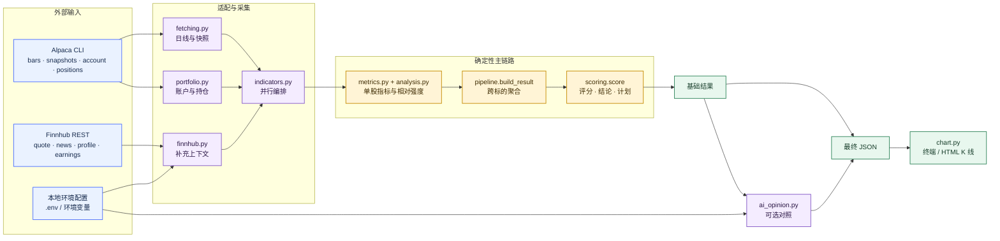
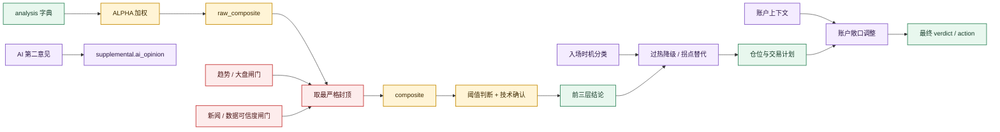

# scripts/ 工程说明

`worth-buy-stocks` 的脚本层维护文档。这里说明运行链路、评分规则、模块边界和验证方式；使用说明见[根目录 README](../README.md)，Codex 执行约束见 [SKILL.md](../SKILL.md)。

运行时以 Python 标准库和本机 Alpaca CLI 为主。Finnhub、Claude API 和 Telegram 都是可选能力，其中 Claude API 额外依赖官方 `anthropic` SDK。

## 导航

- [运行约束](#运行约束)
- [运行架构](#运行架构)
- [评分引擎](#评分引擎)
- [指标计算](#指标计算)
- [回测与校准](#回测与校准)
- [模块职责](#模块职责)
- [常用命令](#常用命令)
- [修改与验证](#修改与验证)

## 运行约束

| 约束 | 实现方式 |
|---|---|
| 评分来源唯一 | `scoring.score()` 生成分数、结论和计划；其他模块只准备输入或展示结果 |
| 计算可复现 | `metrics.py` 和 `scoring/` 对相同输入产生相同输出 |
| 缺失值保真 | 历史不足时返回 `None`，下游显示“无法确认”或“无法评分”，不退化为 0 |
| 外部能力隔离 | 账户、Finnhub、Snapshot 和 AI 意见各自失败时独立降级 |
| 数据角色固定 | 日线进入评分；新闻只降级；账户只调敞口建议；AI 意见只写入补充信息 |
| 凭证不进入结果 | 密钥由 `local_env.py` 读取；账户适配层过滤账号标识 |
| 日线口径稳定 | 默认使用 `iex`；盘中剔除尚未收盘的当日日线，Snapshot 单独展示 |

`indicators.py` 保留旧版再导出，已有的 `import indicators as I` 仍可使用。新增逻辑应放到职责对应的模块，不继续扩大 CLI 文件。

## 运行架构

### 单股运行链路



`indicators.py` 会并行采集 bars、账户、Finnhub 和 Snapshot；Finnhub 内部再按 symbol 并行。`pipeline.build_result()` 负责补齐 SPY / QQQ 相对强度和市场状态，再逐只调用 `scoring.score()`。Snapshot 与 Finnhub 原始上下文写入 `supplemental`，不进入排名分。

`scanner.py` 复用同一条分析与评分链路，额外执行：股池获取 → 流动性初筛 → 批量评分 → 候选提取 → 新闻复核。无需在外层重复拆分抓取步骤。

### 并行数据契约

外部并行采集只允许产出 `bars`、`news_context`、`account_context`、`finnhub_context`、`snapshot_context` 或 `ai_opinion` 等约定结构。评分仍由主链路统一执行，不接受多个评分结果投票。

契约定义见[并行采集数据契约](../references/agent-contracts.md)。校验命令：

```bash
python3 scripts/validate_agent_contract.py --kind <kind> <artifact>.json
```

可选上下文校验失败时丢弃该上下文；核心 bars 校验失败时停止评分。

## 评分引擎

### 决策流程



### 排名分

`raw_composite` 按可用权重重新归一到 0–100；某个非核心因子缺失时不会直接记 0。相对强度缺失属于核心数据不完整，最终返回 `无法评分`。

| 因子 | 权重 | 计算口径 |
|---|---:|---|
| `momentum` | 55 | 风险调整 6 个月动量占 60%，12-1 动量占 40%，分别经 logistic 映射 |
| `rel_strength` | 35 | 3 个月和 6 个月各取相对 SPY / QQQ 的较弱值，再取均值并映射 |
| `efficiency` | 10 | 30 日 Kaufman 效率比，截断到 `[0, 1]` |

logistic 映射统一采用：

```text
score = 1 / (1 + e^(-k × (x - x0)))
```

`x0` 是 50 分对应点，`k` 控制曲线陡度。具体参数集中在 `scoring/factors.py`；部分参数仍是手工设定，修改时必须同步 Model Card。

### 风险闸门与结论

| 条件 | 分数上限 |
|---|---:|
| 价格低于 MA200，且 MA200 下行 | 55 |
| 价格低于 MA200 | 70 |
| 周线均线空头排列 | 50 |
| 价格低于 MA60 | 65 |
| SPY 低于自身 MA200 | 65 |
| 高危事件红旗 | 50 |
| 中危事件红旗或数据存疑 | 74 |

技术确认不进入排名分。`technical ≥ 0.50`、`volume ≥ 0.40`、`trend_quality ≥ 0.40` 全部满足，才允许高分标的进入 `是`。

| composite 与条件 | 基础结论 |
|---|---|
| 缺少 composite 或相对强度 | `无法评分` |
| `≥ 75`、无趋势闸门、确认通过 | `是` |
| `≥ 75`、确认不足 | `观察` |
| `60–74.9` | `观察` |
| `< 60` | `否` |

新闻利好、分析师目标价和估值叙事只回显，不会提高分数。事件红旗通过 `min(cap)` 进入最终封顶。

### 入场时机

入场时机只改变结论、动作和计划，不改 `composite`。

| 分类 | 判定重点 | 处理 |
|---|---|---|
| `overextended` | 距 MA20 ≥ 3 ATR，或 RSI14 ≥ 80，或软阈值同时满足 | 将基础 `是` 降为 `观察`，给出回踩价 |
| `pullback_reversal` | 趋势仍有效，先高后低形成回调，完成日线反转，且至少两个独立触发信号 | 可替代 technical / trend_quality 确认；volume 必须明确达标 |
| `pullback_no_trigger` | 已回调但反转信号不足 | 保持原结论 |
| `trend_continuation` | 趋势正常推进且未过热 | 保持原结论 |
| `trend_broken` | 中期趋势结构破坏 | 交给趋势闸门处理 |

时机阈值属于 v1.1 的待验证参数。`forward_log.py` 会记录介入前结论和时机分类，跨模型版本不得混算。

### 仓位、计划与账户

反波动率仓位建议：

```text
仓位比例 = min(20% / 3 个月年化波动率, 1) × composite / 100
```

`trade_plan.py` 使用 ATR14、MA60 和近 30 日结构生成入场、回踩、突破、追价上限、保护价、2R / 3R 止盈和移动止损。账户上下文不改 `composite`，但可以把最终结论调整为 `持仓需减风险`。

### 可选上下文

| 上下文 | 模块 | 作用 |
|---|---|---|
| 当日 Snapshot | `fetching.py` | 展示最新价、报价和成交，不参与评分 |
| 账户与持仓 | `portfolio.py` | 计算当前敞口、目标仓位和持仓处理建议 |
| Finnhub | `finnhub.py` | 补充 quote、profile、news、earnings，并提炼事件风险候选 |
| 手工新闻上下文 | `--llm-context-file` | 输入可验证红旗、数据可信度和来源 |
| AI 第二意见 | `ai_opinion.py` | 评分后生成 buy / watch / avoid 对照，只写入 `supplemental` |

AI 意见载荷采用字段白名单，输入中不含 `verdict`、`composite` 和 `trade_plan`。一致或分歧由脚本比较，不采用模型自述。详细设计见 [AI opinion overlay](../docs/ai-opinion-overlay-design.md)。

## 指标计算

| 处理 | 当前实现 |
|---|---|
| EMA / MACD 预热 | MACD 使用 SMA-seeded EMA，最低历史约为 `slow + signal + 5` |
| 历史不足 | 指标返回 `None`，缺失项从可用权重分母剔除 |
| 周线聚合 | 按实际交易周聚合，不按每 5 根日线硬切；未完成周标记 `last_week_partial` |
| 盘中日线 | `fetching.py` 剔除未收盘的当日日线，保证评分只使用完成数据 |
| 相对强度 | 同一日期截面对比 SPY / QQQ 的 3 个月和 6 个月收益 |
| 流动性 | 20 日均成交额低于 500 万美元只记录警示，不封顶 |

指标原语集中在 `metrics.py`，不触网、不读写文件。新增指标应保持纯函数，并为历史不足、边界值和典型路径补单元测试。

## 回测与校准

| 脚本 | 用途 | 方法 |
|---|---|---|
| `backtest_factor_ic.py` | 检查单因子方向 | 截面 Spearman IC |
| `backtest_score.py` | 检查综合评分与确认层 | 分桶、五分位价差、截面 IC、确认层 A/B |
| `backtest_robustness.py` | 检查结果稳定性 | 非重叠窗口、regime / 行业中性拆分、bootstrap CI、幸存者探针 |
| `forward_log.py` | 积累样本外记录 | 固化当日评分，满 63 个交易日后按结论和时机分类对账 |

使用 Spearman 是因为评分关注排序，且秩相关不易被单只股票的极端收益主导。采用截面 IC 是为了减少市场整体涨跌对结果的干扰。

当前 Model Card 的关键结论：

- 校准样本为 2020-07 至 2026-06，结果均属于样本内证据。
- 45 只手工大盘股篮子可测得正 IC，但存在明显的后见之明。
- 扩展到 132 只规则化股票并加入退市样本后，63 日全样本 IC 为 `+0.013`，置信区间跨 0，五分位毛价差为 `-0.64%`。
- 样本只包含 2022 一个熊市，regime 结论不能外推为稳定规律。
- logistic 参数、确认阈值、封顶值和结论分界仍含手工自由度。

因此，`composite` 用于统一执行纪律和风险过滤，不应解释为已经验证的宽票池选股 alpha。完整参数、证据与版本记录见 [Model Card](../docs/model-card.md)。

## 模块职责

| 模块 | 职责 |
|---|---|
| `indicators.py` | 单股 CLI；并行采集外部上下文，调用主链路并输出 JSON；兼容旧版再导出 |
| `pipeline.py` | 跨标的聚合、SPY / QQQ 相对强度、市场状态和 overlay 合并 |
| `analysis.py` | 单股分析与跨标的相对强度计算 |
| `metrics.py` | 技术指标、量化因子、周线聚合和入场时机原语 |
| `scoring/engine.py` | 评分主流程与最终结构组装 |
| `scoring/factors.py` | ALPHA、技术、量价和趋势质量映射 |
| `scoring/gates.py` | 趋势闸门、事件封顶、确认阈值和数据标记 |
| `scoring/trade_plan.py` | 反波动率仓位与计划价位 |
| `scoring/account_overlay.py` | 当前持仓、目标敞口和持仓结论调整 |
| `fetching.py` | Alpaca 日线与 Snapshot 拉取、分页、去重和完成日线处理 |
| `portfolio.py` | Alpaca 账户和持仓读取、归一化与敏感字段过滤 |
| `finnhub.py` | Finnhub 请求、错误归一化和事件风险候选提炼 |
| `ai_opinion.py` | 可选的评分后第二意见与结构校验 |
| `local_env.py` | `.env` 查找与可选凭证读取 |
| `agent_contracts.py` / `validate_agent_contract.py` | 并行产物契约定义与 CLI 校验 |
| `scanner.py` | 全市场扫描、流动性初筛、两轮评分和新闻复核 |
| `chart.py` | 终端 K 线、自包含 HTML 图和计划价位线 |
| `notify_telegram.py` | Telegram 文本推送 |
| `backtest_common.py` / `backtest_*.py` | 历史面板、统计原语和三类回测 |
| `forward_log.py` | 按模型版本记录和评估前瞻结果 |
| `utils.py` | 通用数值归一化工具 |

## 常用命令

以下命令均从仓库根目录运行。完整环境配置见[本地环境设置](../references/setup.md)。

### 运行与展示

```bash
# 单股评分；账户、Finnhub、Snapshot 和 AI 意见默认按本地配置自动启用
python3 scripts/indicators.py --symbols AAPL,SPY,QQQ --feed iex --adjustment split

# 加入手工新闻风险上下文
python3 scripts/indicators.py --symbols AAPL,SPY,QQQ \
  --llm-context-file news_context.json

# 全市场扫描；可用 --entry pullback 只保留回调拐点
python3 scripts/scanner.py --feed iex --top 20

# 生成带计划价位线的终端 K 线和 HTML 图
python3 scripts/indicators.py --symbols AAPL,SPY,QQQ > result.json
python3 scripts/chart.py --symbol AAPL --plan result.json --html

# 推送已有摘要
printf '%s' "结论文本" | python3 scripts/notify_telegram.py
```

### 离线复盘

```bash
# 从文件读取 multi-bars JSON，不触网
python3 scripts/indicators.py --input bars.json --symbols AAPL,SPY,QQQ

# 注入离线 overlay；其他文件还支持 finnhub / snapshot / ai_opinion
python3 scripts/indicators.py --input bars.json --symbols AAPL,SPY,QQQ \
  --account-context-file account_context.json

# 离线扫描
python3 scripts/scanner.py --input scan_fixture.json --verify-news off

# 用离线 bars 画图
python3 scripts/chart.py --input bars.json --symbol AAPL --count 30
```

### 回测与前瞻日志

```bash
python3 scripts/backtest_factor_ic.py
python3 scripts/backtest_score.py
python3 scripts/backtest_robustness.py

python3 scripts/forward_log.py record
python3 scripts/forward_log.py evaluate
```

### 测试与契约校验

```bash
python3 -m pytest tests/
python3 scripts/validate_agent_contract.py --kind result result.json
```

## 修改与验证

- 修改权重或阈值：更新 `scoring/constants.py`、`scoring/factors.py` 或 `scoring/gates.py`，同步更新 Model Card 的版本、动机和证据。
- 修改计划价：更新 `scoring/trade_plan.py`；修改账户处理规则：更新 `scoring/account_overlay.py`。
- 修改回测篮子或窗口：更新 `backtest_common.py`，保留前后口径说明。
- 修改 artifact 结构：先更新 `references/agent-contracts.md`，再更新 `agent_contracts.py` 和对应测试。
- 新增纯计算：在 `metrics.py` 或 `scoring/` 中实现，并补 `tests/test_*.py`。
- 新增外部数据源：放入独立适配模块，明确失败降级方式，避免让网络状态渗入纯计算层。
- 修改冻结参数后必须提升 `model_version`；`forward_log.py` 不合并不同版本的记录。

提交前至少执行：

```bash
python3 -m pytest tests/
python3 scripts/indicators.py --help
python3 scripts/scanner.py --help
git diff --check
```
